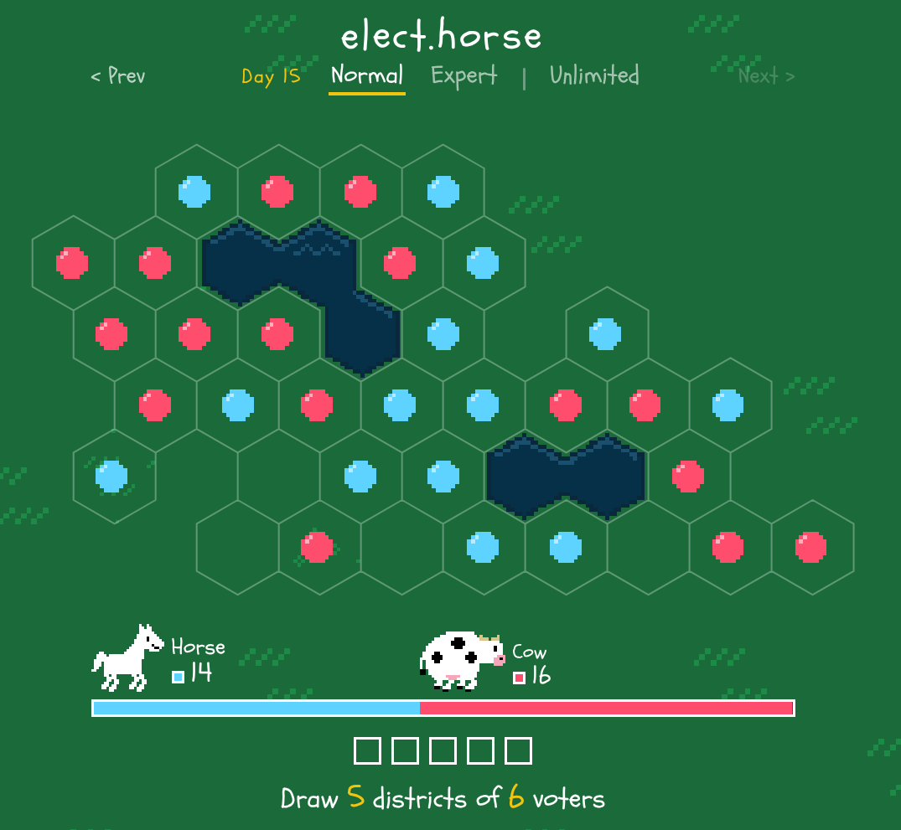

What is Gerrymandering and how does it affect elections?

The following are some non-partisan class activities and discussions

## What is Gerrymandering?

According to the Washington Post, gerrymandering is "The process of re-drawing district lines to give an advnatage to one party over another."

In the United States, both political parties use gerrymandering for their advantage. 

Here is a non-partisan video from a journalist at the Washington Post explaining how gerrymandering works. At the end of the video, they highlight examples of "gerrymandered" districts in Maryland, North Carolina, Florida, and Texas.

<iframe width="700" height="393" src="https://www.youtube.com/embed/bGLRJ12uqmk?si=NmZt3k-vkp1NjSqG" title="YouTube video player" frameborder="0" allow="accelerometer; autoplay; clipboard-write; encrypted-media; gyroscope; picture-in-picture; web-share" referrerpolicy="strict-origin-when-cross-origin" allowfullscreen></iframe>

Data science is related to gerrymandering because the people who analyze the maps of district boundaries, and the people who design possible new boundaries use spreadsheets and other statistical tools to understand how a particular map favors one political party more than the other and by how much.

<b>New vocab word: redistricting</b> 
The task of drawing new maps is called "redistricting"
 

In most US states, redistricting happens every few years because, as people move to and move away from an area, the total number of people living in that area may increase or decrease, so it is appropriate to reconsider the district boundaries so that each district contains approximately the same number of voters.

## The "Elect Horse" Activity

[{width=600 fig-align="center"}](http://elect.horse/tutorial){target="_blank"}

Disclaimer: The [Elect horse](http://elect.horse/tutorial) activity was not developed by the STEMcoding project. We do not know the group involved. We're just mentioning it here because we think it's a great educational tool and it appears to us to be non-partisan and presently it does not have any ads.

Here is the premise: On a farm there is the horse party and the cow party. More voters associate with the cow party than the horse party. Your job is to click the hexagons to create five districts of 6 voters each so that the horse party can win three out of the five districts, which is a majority.

Can you win a majority for the horse party on [Normal mode](http://elect.horse)? Can you win a majority for the horse party on [Expert mode or Insane mode](https://elect.horse/practice) where there is more than one other party?

## Class discussion questions

Here are some questions to consider with your class:

* Does it make you more or less interested to vote to know that, in some of the races you are voting on, the map strongly favors one candidate over the other? Do you feel like your vote on those races still sends a message about what you care about even if the candidate you like will probably lose?

* Would you ever consider donating money to a candidate or spending your time helping a candidate running in a district where they are not likely to win because of the way the map is drawn? Does their chance of winning affect your interest in helping them?

* What might it feel like to be the candidate who is unlikely to win because of the way the district map is drawn? Would you run anyway?

* Although data scientists and legal experts have tried to come up with statistical methods to draw fair political maps, there is no method that exists yet that everyone can agree on. <b>How would you draw a political map?</b> Would you group together communities based on geography, roads, schools or other considerations?

## Other links

* [New York Times detailed ranking of the most to least Gerrymandered US states as of 2026](https://www.nytimes.com/interactive/2026/10/26/upshot/gerrymandering-ranking.html)

